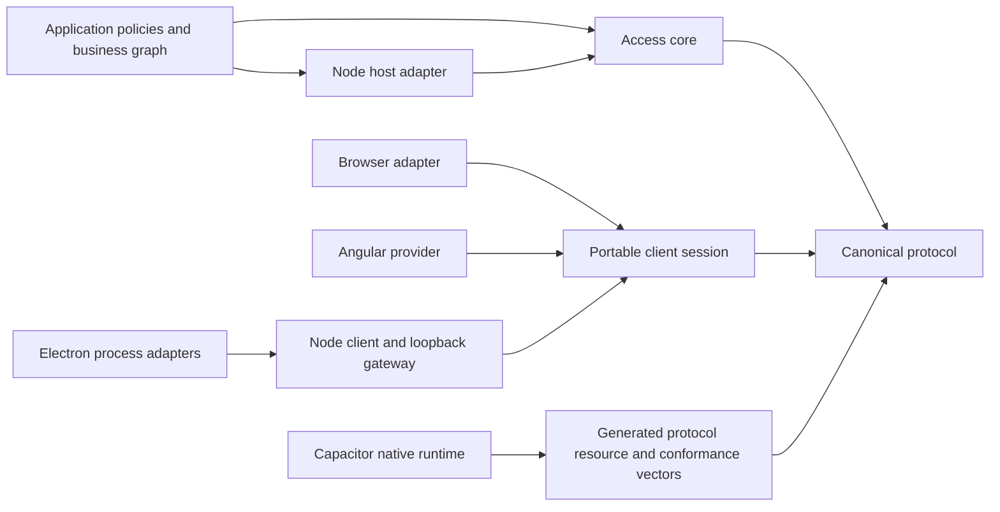
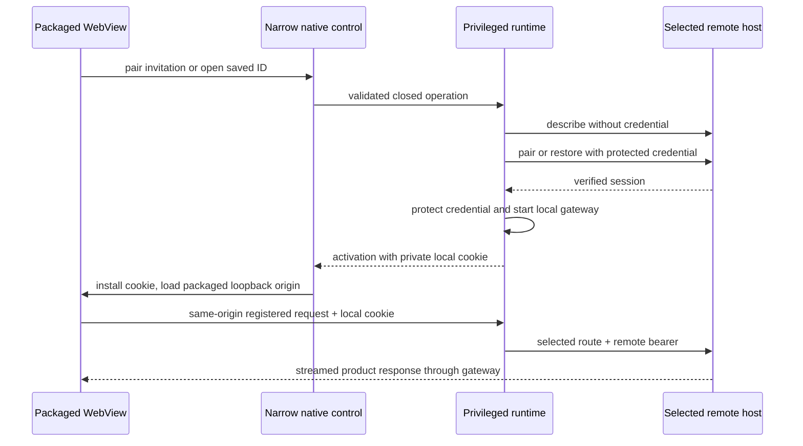

# Remote access implementation handbook

**Status: implemented SDK source contract, with binding integration rules and separate consumer migrations.**

This handbook describes the current `0.1.0` source, its ownership boundaries and the behavior a replacement implementation must preserve. It is grounded in the canonical schemas, runtime adapters and colocated specs. Source inspection does not establish package publication, a successful latest acceptance run or a real device journey. Executed evidence belongs in the [verification record](../../guides/testing.md); the [implementation contract](../../plan.md) defines the binding delivery scope.

Three distinctions apply throughout:

- **Current SDK:** the nine packages implement the owners and public entry points described below. Limits and defaults refer to those implementations, rather than an imagined universal transport.
- **Binding application integration:** the application must supply its identity, business graph, route policy, persistence locations, packaged content and lifecycle. The SDK does not infer these responsibilities or make an application remotely accessible merely by being installed.
- **Consumer migration:** Symphony and Weasel must replace their competing connection owners and prove their own product journeys. Their integration and rollout are separate from SDK source availability. Native compilation is separate from simulator interaction, camera permissions, real LAN access and device lifecycle evidence.

## Outcome and execution authority

A running application consciously enables access on a private local-network interface, creates a short-lived invitation and admits a device that possesses it. The device receives only the application's registered capabilities and operations. A successful host-side revocation removes its durable grant and cancels its live requests and event channels.

The host application retains the only business execution graph. Remote does not introduce another datastore, provider runtime, generic desktop IPC endpoint or arbitrary destination proxy. The same original application validators and services execute an admitted remote operation. Network loss cannot undo an already admitted product mutation.

HTTP LAN is an explicit unencrypted mode. QR possession authorizes the device; it does not supply network confidentiality or authenticate an HTTP server against an active network attacker. No domain, hosted control plane, issuer or public relay is needed for that mode. HTTPS consumes application-supplied certificates and preserves normal client verification.

## Package boundaries and entry points

Every SDK package publishes ESM JavaScript and declarations from `dist` under version `0.1.0`. Consumers use its package exports. A workspace TypeScript alias, copied source tree or package-manager patch is not a substitute for a valid packed dependency graph. Yarn resolves sibling `workspace:*` dependencies when producing distributable packages; verify the resulting artifacts independently of this checkout.

| Package and public import                          | Owned responsibility                                                                                                                                                | Direct SDK dependencies and environment                                                                                       |
| -------------------------------------------------- | ------------------------------------------------------------------------------------------------------------------------------------------------------------------- | ----------------------------------------------------------------------------------------------------------------------------- |
| `@pixel-brewery/remote-protocol`                   | Canonical Zod wire/storage/native-control schemas, identities, errors, byte ports, route metadata and path/address predicates. It owns protocol version one.        | No other SDK package; Zod `4.6.7`. Portable, without Node or browser globals.                                                 |
| `@pixel-brewery/remote-core`                       | Serialized pairing, durable device authority, activation intent, sanitized administration/events and deny-by-default route matching.                                | Protocol. Injects clock, cryptography and atomic storage; no platform or product models.                                      |
| `@pixel-brewery/remote-client`                     | One selected host's session lifecycle, bounded restore, uncertainty classification, safe connection profiles and narrow native control facade.                      | Protocol. Injects connector, clock and profile/credential ports; no platform globals.                                         |
| `@pixel-brewery/remote-node/host` and package root | Actual HTTP/HTTPS private-interface host, original-stream application dispatch, packaged assets, cookie/bearer authorization and owned request/WebSocket lifetimes. | Core/protocol; Node and `ws`. Host is the root entry; client/storage functionality has explicit subpaths.                     |
| `@pixel-brewery/remote-node/client`                | Numeric private-peer connector and transport, streamed authenticated requests/WebSockets, protected loopback packaged-content gateway.                              | Client/core/protocol, Node, `ws`. Contains no generic proxy or renderer credential API.                                       |
| `@pixel-brewery/remote-node/persistence`           | Atomic private JSON implementation of the core access-store port.                                                                                                   | Core/protocol and Node filesystem. The app supplies the path and one-writer lifecycle.                                        |
| `@pixel-brewery/remote-node/security`              | Node entropy/hash comparison and the product-neutral TLS material/provider contracts.                                                                               | Protocol and Node crypto/TLS types. No issuer or shared key is embedded.                                                      |
| `@pixel-brewery/remote-browser`                    | Same-origin cookie transport, fragment invitation handling, HTTP-compatible random IDs, browser clock, bounded WebSocket recovery and incremental SSE decoding.     | Client/protocol. Receives browser APIs explicitly; importing the package starts no connection.                                |
| `@pixel-brewery/remote-angular`                    | Functional provider and read-only Signal projection over the same portable session.                                                                                 | Client, with Angular Core peer `>=22.2.6 <23`. Owns no second connection state machine.                                       |
| `@pixel-brewery/remote-electron/main`              | Main-side sender admission, OS-encrypted credential vault and local-view activation.                                                                                | Client/node/protocol, Electron peer `>=45 <46`. Main mediates credentials; it does not own network application work.          |
| `@pixel-brewery/remote-electron/preload`           | Frozen, schema-validated connection controls over an application-owned fixed IPC channel.                                                                           | Same package graph. The root entry exposes only the safe preload bridge type. Keep runtime imports in their process subpaths. |
| `@pixel-brewery/remote-electron/utility`           | Privileged selected-peer connections, safe profile persistence and protected local gateways.                                                                        | Client/node/protocol. The application supplies the Main-mediated credential port and utility supervision.                     |
| `@pixel-brewery/remote-capacitor`                  | Narrow JavaScript bridge plus actual Android/iOS runtime, scanner, protected storage and local WebView gateway implementations.                                     | Browser/client/protocol, Capacitor Core peer `>=8.6.2 <9`; Kotlin/Swift own native I/O.                                       |
| `@pixel-brewery/remote-testing`                    | Memory access/credential stores, deterministic clock, fake connector, protocol and route conformance vectors.                                                       | Core/client/protocol. Test-only composition, never a production credential fallback.                                          |

The repeated Node and Electron rows describe subpaths of two packages; the SDK contains **nine packages**. Dependencies point inward: protocol → consumed by core/client → consumed by runtime adapters. Angular composes client state; Electron composes Node I/O; Capacitor keeps native transport authority outside JavaScript.



The arrows mean dependency or contract consumption, not execution direction. Kotlin/Swift do not execute the TypeScript client state machine; they implement the same canonical wire and authority contracts through generated resources and native ports.

## Identity and public wire model

An installation identity is `{ appId, hostId }`. `appId` matches `^[a-z][a-z0-9.-]{0,79}$`; the application persists a nonempty `hostId` of at most 160 characters. Hostname, IP, port and device display name are not installation identity. Persist the installation identifier before creating the access service and use the same identity at every host/client boundary.

A public host descriptor contains exactly:

```text
identity: { appId, hostId }
name: trimmed label, 1..160 characters
protocolVersion: 1
endpoints: at most 8 { id, transportId, origin }
```

Endpoint IDs and transport IDs are nonempty and at most 120 characters. An origin is HTTP(S), without user information, query, fragment or a non-root path. The protocol describes an endpoint; its runtime adapter additionally enforces destination policy. Native selection accepts a numeric private address, not a DNS lookup or arbitrary browser-supplied destination. A deliberate loopback exception exists for isolated tests and must not become an application's normal policy.

A session descriptor is `{ host, principal }`. Its principal is `{ appId, hostId, deviceId, capabilities }`; device IDs are bounded to 160 characters and there are at most 256 capability names of 1..160 characters. Every session is checked against the selected app and installation. This DTO has no bearer, cookie, credential hash or product settings.

The reserved control routes are:

| Method and path               | Authorization and result                                                                                |
| ----------------------------- | ------------------------------------------------------------------------------------------------------- |
| `GET /__remote/v1/host`       | Public descriptor; no product data or credential.                                                       |
| `POST /__remote/v1/pairings`  | Possession of a valid invitation and the canonical attempt request; `200 paired` or `202 pending`.      |
| `GET /__remote/v1/session`    | Existing device credential; `200 { host, principal }`, or `401` when pairing is needed.                 |
| `DELETE /__remote/v1/session` | Existing device credential; durable self-revocation followed by `204` and cookie expiry where relevant. |

The host owns these routes. Product registrations cannot occupy `/__remote` or its descendants. Unknown reserved methods/paths fail closed. Protected native loopback views expose only safe authenticated host/session metadata and self-revocation; pairing POST is not a proxy operation there.

## Pairing as a durable state transition

The out-of-band bootstrap is `{ appId, hostId, origin, challenge, expiresAt }`. `expiresAt` is a UTC ISO timestamp with an exclusive deadline. The default host challenge has 32 random bytes, lasts five minutes and is retained by digest. A custom lifetime must be positive and no longer than fifteen minutes. A copied invitation is as sensitive as its QR representation.

`createRemotePairingUrl` encodes the invitation in the origin's fragment:

```text
http://<selected-private-address>:<port>/#pair=…&app=…&host=…&expires=…
```

The fragment is not an HTTP request target. Do not log the full URL, serialize it into general application snapshots or persist it as a connection profile. The renderer may present it only for the operator's explicit pairing action.

The request is `{ attemptId, deviceName, challenge, credentialMode }`: `attemptId` is 16..160 characters, the trimmed name is 1..120, the challenge is 32..256, and the credential mode is `cookie` or `bearer`.

| Transient invitation state             | Event                                         | Consequence                                                                                                        |
| -------------------------------------- | --------------------------------------------- | ------------------------------------------------------------------------------------------------------------------ |
| Issued                                 | First valid submission                        | Bind permanently to that `attemptId`, trimmed device name and credential mode.                                     |
| Bound, default `qr-possession` policy  | Grant attempt                                 | Create one device credential and atomically append its hash before returning success.                              |
| Bound, optional `host-approval` policy | Submission                                    | Return `pending` with `pairingId` and deadline; do not admit product requests.                                     |
| Pending approval                       | Local approve                                 | Commit the grant; the client retrieves it by repeating the same attempt.                                           |
| Pending approval                       | Local reject                                  | Consume the invitation without creating a grant.                                                                   |
| Already granted, still valid           | Same attempt/name/mode                        | Return the same transient result, recovering a lost response without adding another device.                        |
| Bound or granted                       | Different attempt/name/mode                   | Reject as consumed; never reassign the challenge.                                                                  |
| Any transient state                    | Deadline, rebind, stop, disable or revoke-all | Invalidate the invitation/recovery context. Existing durable grants remain unless the operation also revokes them. |

The expiry/rebind generation is checked at admission. The core serializes authority changes; authorization waits behind pending mutations. It does not persist plaintext credentials to make retries survive a process restart. A completed grant is cached only in transient memory until expiry so the original attempt can recover its credential. After restart or deadline, an unknown lost credential cannot be reconstructed from its hash; pair again and explicitly remove an orphaned host grant when necessary.

### Cookie and native credential delivery

Browser pairing sets an HttpOnly, SameSite=Strict cookie at Path=/ with a one-year Max-Age and Secure when the listener is HTTPS. Its default name is scoped to app/host; an application may supply an explicit compatibility name. Cookie-mode JSON omits the bearer entirely. A durable host grant itself has no automatic expiry field: invitation expiry and browser cookie expiry are different from revocation.

Bearer mode is for privileged transports. The host returns the credential once as part of the recoverable transient pairing result. The native Node adapter validates the session identity, awaits `IRemoteCredentialStore.set(identity, credential)` and removes the credential before returning its paired descriptor. Later native requests restore only that identity's protected value and place it in Authorization, not a URL. A 401 restoration clears the stale local credential. The host rejects malformed bearers and duplicate matching cookies; the raw private record is never its administration response.

A native/client retry ID is an idempotency key for **pairing only**. The host request ID is correlation metadata, not a product mutation idempotency guarantee. Application writes need their own explicit deduplication contract if they can be retried safely.

### Commit order and storage failures

The private state is a strict version-one record:

```text
{ version: 1, identity, enabled,
  devices: [{ id, name, tokenHash, capabilities, pairedAt, lastSeenAt? }] }
```

There are at most 100 devices. Timestamps are UTC ISO values. The injected security port owns digest representation; the storage schema bounds hashes to 32..256 characters. `NodeRemoteSecurity` uses SHA-256 hexadecimal digests, cryptographic entropy and constant-time digest comparison. A replacement must preserve its existing digest algorithm when importing grants.

`IRemoteAccessStore.load()` returns unknown data, or null for absence. Initialization validates the complete record and exact identity. Absence creates and saves disabled state. Corrupt or foreign data is an error, not permission to overwrite a file with an empty enabled host.

`save(state)` replaces the complete record atomically; rejected writes must preserve the previous authoritative state. Only after the awaited save succeeds does the core replace its in-memory state and emit authority events:

- **Grant:** save hash → publish paired result → issue cookie or native bearer response.
- **Single revoke:** save removal → invalidate retry material for that device → emit revocation → transport cancels its requests and event connections.
- **Revoke all:** save empty devices → invalidate every invitation → emit each device's revocation.
- **Failed revoke:** retain the preceding grant and report failure. Do not claim success or close a connection as proof of a durable change.

`JsonRemoteAccessStore` creates a private temporary file exclusively with mode `0600`, writes and flushes it, closes it, and atomically renames it into the app-selected location. Parent creation uses `0700`; a symbolic-link authorization file is rejected. This is one-writer file replacement, not a multi-process database or a claimed transaction across unrelated product stores. The application must own directory placement, backups, retention and platform-specific crash/recovery requirements.

Authorization does not persist a write on every read. If the application records last-use observations, serialize them through its same state writer and merge them with current grants. A delayed observation must never restore a revoked device.

## Route admission and application authorization

Each product registration supplies `{ id, method, path, kind, capabilities, retry, maxRequestBytes? }`. The supported methods are GET, HEAD, POST, PUT, PATCH and DELETE; modes are `http`, `sse` and `websocket`. All listed capabilities must be present. An empty capability list means any paired device, not a public unauthenticated route.

`safe-read` is valid only for GET or HEAD and permits an explicit caller policy; it does not enable automatic operation replay. Every mutation remains `never`. Default request-body admission is four MiB unless an operation explicitly declares another safe integer budget.

The registry resolves exact methods and normalized path segments. A complete `:parameter` segment matches exactly one nonempty segment. Static routes win over routes with more parameters. Equivalent parameter templates are duplicates; equally specific multiple matches are denied. There is no catch-all wildcard, arbitrary RPC method, destination URL or generic filesystem path parameter.

Path authority is normalized once. The input is origin-form, at most 16,384 characters, with optional query retained by transports. The pathname matcher ignores the query. Reject protocol-relative/absolute forms, fragments, malformed escapes, controls/spaces, backslashes, repeated slashes, encoded separators, dot segments and residual ambiguous escapes such as `%252f`. Encoded `?` or `#` cannot change the path boundary. A literal `+` stays a plus; do not apply form-URL-decoding to path segments. The native matchers consume shared allow/deny vectors with these semantics.

After credential and capability admission, `IRemoteApplicationAdapter.authorize` may apply product resource rules. The Node host rechecks authorization after this asynchronous gate. The application dispatcher receives the original `IncomingMessage`/`ServerResponse` and a context `{ requestId, operationId, principal, signal }`. It must still:

- validate route-specific headers, query, payload and response DTOs through its canonical contracts;
- resolve current tenant/workspace/resource ownership rather than trusting a preceding client projection;
- validate current workflow state and operation permissions;
- observe the signal during product streams and before starting a later mutation after asynchronous validation;
- release its subscriptions/files/subtasks when the request lifetime ends.

Revocation cancels network ownership. It is not rollback of work already committed by the business service. A job that legitimately outlives its initiating request needs an explicit application lifecycle and cancellation contract.

## Host lifecycle and private listeners

Constructing services and transport adapters does not bind a listener. Initialize the access core first, then let the host reconcile saved activation. A missing record starts disabled. Activation intent and network availability are independent.

| Host action/state | Observable ordering                                                                                                                                                                                     |
| ----------------- | ------------------------------------------------------------------------------------------------------------------------------------------------------------------------------------------------------- |
| `initialize()`    | Restore canonical authority and immutable asset root; start only when saved intent is enabled.                                                                                                          |
| `enable()`        | Commit enabled intent before binding. A bind failure reports unavailable while retaining that saved intent.                                                                                             |
| `reconcile()`     | Serialize interface reevaluation. Same selected address with live listeners is a no-op. Otherwise close old listeners/streams, invalidate invitations and bind again.                                   |
| `disable()`       | Set a runtime halt, close owned listeners/streams, then save disabled intent. On a save failure remain unavailable/stopped; background reconciliation cannot reopen this runtime until explicit enable. |
| `dispose()`       | Close this owner and invalidate transient invitations without erasing saved grants or activation intent. Later startup needs a new owner.                                                               |

States are `disabled`, `starting`, `available`, `rebinding`, `stopping`, `unavailable` and `disposed`. Status contains only public host metadata, sanitized administration data and a safe optional error code. The core does not invent runtime network state or a product UI indicator.

Automatic selection chooses one non-internal private IPv4 interface, preferring Ethernet/Wi-Fi-like adapters and excluding tunnel/VPN/container/bridge/VM names. Explicit binding accepts supported numeric private addresses; public/DNS/wildcard addresses are rejected. Automatic selection is not a default-gateway routing probe. There is no UPnP, port forwarding, public discovery or hosted relay. Private binding is the incoming network boundary; the host does not claim a separate source-address firewall for every inbound peer.

The host requires one exact Host header, rejects a present foreign Origin, and rejects Fetch Metadata other than same-origin/none when supplied. Missing Origin is permitted, including native callers. Cookies and bearer credentials are independently validated. The application must not describe a present-header check as mandatory Origin-header authentication.

The app owns resume/network-change triggers and when to call `reconcile`; the SDK does not install an operating-system background daemon. It also owns graceful Utility/process shutdown and diagnostic reporting. Full application quit removes reachability; keeping a supervised process running may preserve it.

### Runtime budgets

| Boundary                        | Current default or fixed bound                                                                                                                            |
| ------------------------------- | --------------------------------------------------------------------------------------------------------------------------------------------------------- |
| Host endpoints                  | 1 HTTP transport by default; 1..8 explicitly supplied unique listener IDs                                                                                 |
| Port allocation                 | Start 49152; default probes through start+48 inclusively, capped at 65535. Explicit end-start may be at most 128. Port zero is test-only.                 |
| Host TCP / WebSockets           | 128 TCP connections; 64 active plus pending WebSocket upgrades; 1000 HTTP requests per socket                                                             |
| HTTP timeouts                   | 15 s headers, 30 s incoming request, 5 s keepalive                                                                                                        |
| Host control request            | 16,384-byte pairing JSON with application/json media type                                                                                                 |
| Pairing storage                 | 32 transient invitation records by default, configurable to at most 128; 100 devices maximum                                                              |
| Product body                    | Four MiB default; checked declared length and streamed bytes, even without Content-Length                                                                 |
| Node remote transport           | 64 active HTTP operations and 64 sockets by default; 15 s response-header/handshake budget; protocol JSON at most 65,536 bytes with a completion deadline |
| Node local view                 | 64 TCP connections, 64 forwarding/control requests; same HTTP timing defaults; one-second graceful-close budget                                           |
| Browser protocol / byte uploads | 65,536-byte protocol JSON; default byte-upload buffer eight MiB, abortable before dispatch                                                                |
| Browser WebSocket / SSE parser  | 65,536 bytes per message/event by default; explicit lifetime cancellation                                                                                 |
| Saved profiles                  | Portable manager and native platform stores bound profiles to 64; native response schema permits at most 100                                              |
| Native route request policy     | Explicit native config; one MiB default and at most sixteen MiB per route. Set the same intended operation limit on all participating adapters.           |

Streaming responses are not accumulated under a global response-body limit. The application must provide appropriate finite output bounds for JSON/projections and protocol-specific event limits. Long-lived SSE/media requires deliberate product cleanup; a request-header deadline is not a total-stream deadline. Node WebSocket framing allows up to one MiB, while browser/native event defaults are smaller; align the product's event schema with its supported clients.

## Byte requests, events, uploads and media

The portable byte request supplies method, admitted relative path, optional headers/body and abort signal. Body and response are asynchronous iterables of `Uint8Array`. The response preserves status and relevant headers and provides `cancel()`. Every caller consumes its body or cancels it in `finally`; abandoning a response without cleanup retains transport resources.

Node forwards incremental original application bytes with backpressure. It filters authority and hop-by-hop headers, binds authentication to its selected verified identity and refuses redirects. It does not deserialize multipart, rebuild JSON DTOs, run arbitrary destinations or retry a dispatched write. Cancellation closes upstream and downstream resources and releases request/handshake quotas.

The browser byte adapter defaults to **buffered-http1**: it reads only the explicitly supplied async byte iterable into an abortable buffer, at most eight MiB, before one Fetch dispatch. `streaming-fetch` is an explicit alternative using `ReadableStream` and `duplex: 'half'`; its browser/server combination must support Fetch uploads over HTTP/2 or HTTP/3. A failed dispatch never falls back to another upload strategy or replays a body.

An application's existing Fetch/XHR/FormData/File/Blob pipeline is not globally patched or redirected through that byte buffer. A normal same-origin form upload retains the browser-generated multipart boundary and original file stream. In a protected native view its destination is the local gateway, which streams the registered operation to the selected host. Do not set multipart Content-Type manually; the browser supplies the matching boundary.

```ts
const form = new FormData();
form.append('file', selectedFile);
const response = await fetch(session.resourceUrl('/api/upload'), {
    method: 'POST',
    body: form,
    credentials: 'same-origin',
    redirect: 'error',
    signal: uploadLifetime.signal,
});
```

This recipe assumes a ready browser session and an explicit upload route on both host and, where present, native gateway. `resourceUrl` never includes a remote credential. In a native UI it must resolve through the Browser adapter at the protected local origin; a privileged Node connector's remote URL is not a browser credential mechanism.

For media, register GET and HEAD independently when both are supported. Preserve Range/If-Range/validators and the application's 200/206/304/416 decision, Content-Range, Accept-Ranges and binary body. The application owns range validation and resource authorization; the gateway owns HTTP framing. Do not encode an entire media file into a JSON bridge message or put bearer credentials in image/video URLs.

SSE is a registered streaming HTTP operation. Preserve `text/event-stream` and Last-Event-ID where the product uses it. `readRemoteServerEvents` incrementally handles UTF-8, CR/LF chunk boundaries, event type, ID and multiline data; malformed UTF-8 or retained over-budget lines/events fail. It yields an event only after its terminating blank line. It provides neither a business replay log nor automatic mutation retry. The owner cancels the byte response when leaving the view.

WebSocket registration is distinct from ordinary HTTP dispatch. The host validates and authorizes the upgrade, tracks pending/established ownership and cancels it on revocation. The application validates every product message. `BrowserRemoteEvents` owns one same-origin socket and bounded backoff, with no bearer in the URL. It calls `onReconcile` whenever the socket opens; the application reads fresh current state rather than assuming gapless delivery. Unsupported/oversized/policy/normal closes are terminal for that stream; repeated transport failures consume the retry budget.

## Browser session recovery and connection replacement

`IRemoteConnector.connect(endpoint, signal)` returns one owned transport. That transport can describe, restore a session, pair, revoke, request bytes, resolve safe content URLs and dispose. Native connectors verify the expected public identity before reading/sending the protected credential. A changed app/installation is an incompatible selection, not permission to offer the previous credential elsewhere.

`RemoteSession` verifies host protocol/identity and restores authentication before exposing `ready`. Its public state is credential-free:

| State              | Meaning and permitted consequence                                                       |
| ------------------ | --------------------------------------------------------------------------------------- |
| `idle`             | No initialized session.                                                                 |
| `connecting`       | Identity/authentication restoration in flight.                                          |
| `pairing-required` | Verified host with no usable device session.                                            |
| `pairing`          | One identified attempt is in flight.                                                    |
| `pending-approval` | Optional host policy is waiting; preserve the same attempt to retry.                    |
| `ready`            | Verified session; application reads/writes may be admitted by the host.                 |
| `reconnecting`     | Bounded restore scheduled with attempt/retryAt metadata.                                |
| `offline`          | Network failure or exhausted automatic budget; explicit retry remains a product action. |
| `incompatible`     | Identity or protocol mismatch; select the correct host.                                 |
| `revoked`          | Authentication is no longer valid; clear product projections and pair again.            |
| `disposed`         | Permanent end of this owner; no later callback may revive it.                           |

The default restore budget is eight attempts, with 500 ms initial exponential backoff and a 30 s maximum interval. Successful restore notifies reconciliation listeners. Scheduled restore verifies the same selected identity; there is no transparent cross-host failover. `retry()` resets the restore budget. Pairing success is independent of whether a later product snapshot returns 500.

`BrowserPairingLocation` reads and clears the complete invitation fragment. The application keeps a stable attempt ID if it needs reload recovery, clears the fragment only after acknowledged pairing, and stores no bearer in local/session storage. `createBrowserOperationId` uses `getRandomValues` so HTTP-LAN browsers do not depend on secure-context-only `randomUUID`.

The browser connector is same-origin only, uses cookie mode and rejects a paired response that unexpectedly contains a bearer. It rejects product-supplied authority headers. Unknown product writes are never a reason to re-pair automatically or repeat the write. A received 401 moves the canonical session to revoked and aborts owned requests.

`RemoteConnectionManager` serializes safe profile loading, persistence, activation and forgetting. A profile contains `{ id, label, identity, endpoints, selectedEndpointId }`, with no credential or invitation. Activating another profile closes the preceding session before initialization. The application clears its preceding product projection at that transition and guards asynchronous reads by connection generation. The SDK cannot clear application data it does not own.

`disconnect` closes runtime ownership while retaining a profile/grant. `forget` removes local profile and optional protected credential; it does **not** revoke the host's durable grant. Explicit self-revocation or host administration is a separate operation.

Angular's `provideRemoteSession(factory)` creates the same headless session in the selected injector scope, registers disposal with DestroyRef and performs no eager network initialization. `injectRemoteSession()` subscribes to it and returns the original session, a read-only state Signal and derived ready Signal. Destroying a consumer removes its subscription; destroying the provider owns session disposal. Components retain product projections and user commands.

## Native content and credential separation

A native client runs trusted **packaged application assets**, not scripts downloaded from the remote host, in its privileged WebView/renderer context. It opens a protected HTTP loopback origin with an independent random local capability. Native code installs that capability as an HttpOnly, strict same-site cookie before loading content. The remote bearer remains in privileged storage/runtime.



The public native request union is closed: `connections.list`, `connections.open { connectionId }`, `connections.close { connectionId }`, `connections.forget { connectionId }`, and `pairings.complete { bootstrap, deviceName }`. Replies are `connections { connections }`, `view { view }` or `done`. A view is only `{ connectionId, identity, origin }`. Configuration, credential access, arbitrary HTTP requests and filesystem paths are not bridge methods.

The loopback gateway requires its exact Host, the private local cookie, no incoming bearer, an acceptable present Origin and same-origin/none Fetch Metadata when supplied. Requests cannot choose another upstream. It forwards only its immutable product registry and a restricted safe host/session control subset. Authority, forwarded-address and hop-by-hop headers are stripped; upstream Set-Cookie/CORS/CSP cannot replace local authority or policy.

Only packaged assets use the trusted application CSP. Their `style-src 'self' 'unsafe-inline'` supports Mosaik/Angular component styles while `script-src 'self'` continues to prohibit inline scripts. This style allowance is not applied to proxy responses. The product proxy denies script/style/worker/document/iframe/object/embed fetch destinations, rejects active response MIME types such as HTML/JavaScript/ECMAScript/SVG, adds `nosniff`, and supplies a sandbox/default-src-none CSP. Native equivalents add their platform checks. These gates prevent ordinary remote document/script loading through registered product routes; the trusted application must still validate and safely render data rather than evaluate a product payload as code.

Applications may opt into direct provider HTTPS content through the canonical strict `remoteContentPolicySchema` / `IRemoteContentPolicy` contract. `allowHttpsImages`, `allowHttpsMedia` and `allowHttpsConnections` are independent optional booleans; omission is false. Node supplies the immutable policy as `NodeLocalGatewayOptions.contentPolicy`; Electron and Capacitor pass the same product-owned policy to their privileged gateway composition. Only a true flag adds `https:` to the packaged UI's corresponding `img-src`, `media-src` or `connect-src`. Unknown keys, including script-policy fields, and non-boolean values are rejected. This is an explicit product decision to allow ordinary direct HTTPS provider images, videos or feeds, not an arbitrary CSP override. Scripts, top-frame navigation, frames and remote product-proxy response policy retain their existing restrictions. Native WebView subframes must not be considered bridge-isolated without platform evidence; this policy grants no frame allowance. An application whose embedded provider cannot meet that boundary must use a deliberate external HTTPS watch action instead.

### Electron process composition

Main owns Electron sender authority and credential mediation. `ElectronCredentialVault` requires OS-backed safeStorage after app readiness and rejects unavailable or `basic_text` encryption; there is no plaintext fallback. Records are namespaced by SHA-256 of `appId + NUL + hostId` and stored as bounded encrypted values in an atomically replaced private file.

The application supplies a narrow typed Utility proxy. `ElectronRemoteUtility` owns Node connectors, the selected remote bearer lifetime, app-owned profile storage and NodeLocalGateway. Its returned activation includes the **private local** cookie only for Main. `ElectronRemoteController` validates the real IpcMainInvokeEvent, main frame and app-provided trusted-sender predicate; caller-supplied sender metadata cannot authorize it. Main verifies the exact numeric loopback activation, installs the cookie in the intended partition, opens the owned view and returns only the public descriptor.

Preload exposes `createRemotePreloadBridge` over one fixed IPC channel through the application's existing contextBridge. It exposes no generic invoke closure. Use `contextIsolation: true`, renderer sandboxing and no Node integration; the app restricts navigation, permissions, windows and the exact renderer/partition that may invoke control. Main never loads remote HTML as the native application UI. Utility supervision closes connections on process shutdown or replacement. The fixture demonstrates the process boundary; applications still implement their own Main/Utility messaging and protected storage locations.

### Capacitor platform composition

`createCapacitorRemoteBridge()` binds `PixelBreweryRemote` and exposes safe connection controls plus `scanPairing`. It neither patches Fetch/XHR nor accepts JavaScript-supplied route/content/storage configuration.

Android installs immutable `RemoteNativeConfiguration` from the native Application before creating a WebView. It supplies appId, private storage, copied packaged assets and exact routes. Ktor CIO owns selected-peer HTTP/WebSocket streams, bounded protocol reads and cancellation. Android Keystore AES-GCM protects the local credential record. `RemoteBridgeActivity` recreates the trusted Capacitor bridge at the owned loopback origin and disallows arbitrary navigation, mixed content, file access and third-party cookies. Apply the packaged network-security resource: WebView cleartext is denied except loopback; native private-peer networking is separate. The bundled MLKit scanner avoids a runtime model download; camera permission is explicit and denial remains recoverable. The application calls the native configuration owner's dispose when that remote capability exits.

iOS installs and retains `RemoteNativeHost` with immutable app identity, packaged asset directory, routes and an activation callback that recreates `RemoteBridgeViewController`. The host installs the real HttpOnly non-Secure HTTP-loopback cookie before activation. SwiftNIO/NIOTransportServices owns the local listener, URLSession streams the selected peer without redirects, Keychain owns protected records and AVFoundation handles QR scanning. Upload flow is incremental with backpressure and cancellation; the native request does not recreate a body after uncertain dispatch. Supply camera/local-network purpose strings and the fixture's narrow local networking policy; a global arbitrary-load/WebView exception is not the integration contract.

Native gateways apply an application-configured incremental upload ceiling, bounded above by 64 MiB; the tighter default remains in effect unless the application explicitly selects a larger route-compatible budget. This is a total admitted byte count, not an allocation size: native forwarding retains backpressure and a bounded 256 KiB queue rather than collecting the entire body. The effective operation limit is also constrained by the product route's registered `maxRequestBytes`. A product can therefore admit a bounded multipart upload while retaining a four-MiB default on unrelated operations.

The package includes actual native sources and platform tests for Android 24+ and iOS 15+. Native validators consume the generated `remote-protocol-v1.json` and shared conformance vectors and additionally enforce refinements such as plain origins, expected identity and selected endpoints. Regenerate the canonical resource rather than maintaining another handwritten wire schema. Suspend/resume, bridge replacement, LAN permissions, scanner hardware and real background behavior still require platform acceptance; a compiled AAR or simulator build proves none of those journeys by itself.

## Application-supplied ports and TLS

| Application input    | Required contract                                                                                              |
| -------------------- | -------------------------------------------------------------------------------------------------------------- |
| Stable identity      | Persist app-owned hostId; keep product appId fixed and separate from endpoint addresses.                       |
| Access storage       | One active writer, canonical restoration and atomic complete-state save. Migrate before host start.            |
| Cryptography/clock   | Unpredictable tokens, stable digest verification, constant-time comparison and UTC milliseconds.               |
| Product adapter      | Original business pipeline, route-specific schemas, current resource/action admission and cooperative cleanup. |
| Route registry       | Explicit method/path/mode/capabilities/budget; matching native admission policy.                               |
| Assets               | Immutable app-packaged web root; browser-safe imports and no remote privileged scripts.                        |
| Profiles/credentials | Safe metadata separate from protected credentials; app/host namespacing and defined partial-failure recovery.  |
| Process/lifecycle    | Utility/native owner, explicit enable/disable/reconcile/shutdown and product projection invalidation.          |
| TLS                  | App-managed certificate/key/chain/passphrase, renewal notification and client trust configuration.             |

`IRemoteTlsProvider.getMaterial()` supplies the current key/certificate and optional CA/passphrase. An optional subscription announces renewal. `NodeHttpsLanTransport` reloads through that port and changes the server secure context only for the latest outstanding renewal; closing removes the subscription. A failed renewal retains the preceding material and reports a safe TLS-renewal diagnostic. New material affects new handshakes, not retroactive encryption of an existing HTTP stream.

An application may configure HTTP and HTTPS listener adapters together around the same identity, grants and product routes. Native clients select an explicit advertised endpoint. `NodeRemoteConnector` accepts an application-approved certificate authority while retaining verification. Browser and platform-native trust decisions remain with the browser/OS; the SDK does not silently disable them.

Automatic issuance per installation, if the product chooses it, belongs to that product's certificate owner. Generate and protect that installation's key, decide the issuer/trust distribution, renew and notify the provider. A bundled shared private key is not per-installation identity, and a locally self-issued certificate is not automatically trusted by arbitrary browsers. No certificate authority, issuer credential, public domain, DNS automation or hosted issuance service ships in the SDK. A domainless first installation can use explicit HTTP LAN without pretending HTTPS trust already exists.

## Integration recipes

### Host around an existing application graph

The application first creates or restores its durable `installationIdentity`, resolves a private record path and packaged asset root, and defines its existing product adapter/registry. It then composes one access service and one host:

```ts
import { RemoteAccessService } from '@pixel-brewery/remote-core';
import { NodeRemoteHost } from '@pixel-brewery/remote-node/host';
import { JsonRemoteAccessStore } from '@pixel-brewery/remote-node/persistence';
import { NodeRemoteSecurity } from '@pixel-brewery/remote-node/security';
import { createRemotePairingUrl } from '@pixel-brewery/remote-protocol';

const access = new RemoteAccessService({
    identity: installationIdentity,
    store: new JsonRemoteAccessStore(privateRecordPath),
    security: new NodeRemoteSecurity(),
    clock: { now: () => Date.now() },
    capabilities: ['records:read', 'records:write'],
    pairingPolicy: 'qr-possession',
});
await access.initialize();
const host = new NodeRemoteHost({
    identity: installationIdentity,
    name: applicationDisplayName,
    access,
    routes: productRoutes,
    application: existingProductAdapter,
    assetsPath: packagedBrowserRoot,
    contentSecurityPolicy:
        "default-src 'self'; script-src 'self'; style-src 'self' 'unsafe-inline'; img-src 'self' data: blob:; font-src 'self' data:; media-src 'self' blob:; connect-src 'self' ws: wss:; object-src 'none'; frame-ancestors 'none'; base-uri 'self'",
});
await host.initialize(); // respects persisted enabled intent
```

Only the user's enable action calls `await host.enable()`. Generate and display `createRemotePairingUrl(await host.createPairing())` through the existing app UI. Desktop administration awaits disable/revoke operations before reporting success. Resume/network triggers call the same host's reconcile; process shutdown awaits dispose. Inputs such as `existingProductAdapter` are the application's existing owners, not SDK-provided product implementations. The shown host CSP is an explicit app-owned Mosaik configuration; Node host defaults are not silently loosened for every application.

For example, register a GET `/api/records` with `records:read`, and a POST `/api/records` with `records:write`, `retry: 'never'` and a deliberate budget. The handler switches on the admitted operation ID and calls the existing service after its existing validation. Preserve multipart through that same pipeline. A method name in an HTTP body must never select arbitrary desktop IPC.

### Browser and Angular

Use `BrowserPairingLocation` on the real document, construct a same-origin BrowserRemoteConnector, select the invitation's identity/endpoint and create a RemoteSession with the browser clock and cryptographic ID factory. Initialize, pair the same bootstrap/attempt when needed, and clear the fragment after ready. On restore, validate identity before assigning product data. On reconcile, reload product projections. On revoked/incompatible/host replacement, clear them and reject late prior-generation responses. Dispose all streams and the session when their UI owner ends.

An existing generated web API client may keep same-origin Fetch/XHR, forms, media URLs and events. The SDK supplies session and gateway authority rather than replacing every application endpoint with a generic JSON bridge. Bind route definitions to those actual operations on both sides. Angular may use the provider/Signal adapter or compose the portable session in its existing product port; it must not create both as competing owners for the same connection.

### Electron or Capacitor using the existing web application

Package the application's browser assets once. Install immutable native route policy and protected storage. Expose the closed native controls for choosing a saved connection or scanning an invitation. Verify/pair in the privileged runtime, start the protected loopback view, install its local cookie and only then load the packaged content there. Ordinary product requests target that local origin and reach the same remote backend graph. Leave local workspace activation and privileged desktop administration in their existing separate APIs.

Closing a view cancels its streams. Selecting another connection closes the old owner and clears old product projections before displaying new data. Forgetting is local removal, while host revocation removes durable remote authority. Handle each outcome explicitly in product copy and tests.

## Errors, recovery and diagnostics

The canonical wire error is `{ error: { code, message } }`. Codes are `invalid-request`, `unauthorized`, `forbidden`, `expired`, `consumed`, `not-ready`, `incompatible`, `resource-limit`, `persistence`, `network`, `disposed` and `unknown-outcome`. Localized user copy belongs to the application.

The Node host maps malformed input to 400, unauthorized to 401, forbidden to 403, expiry to 410, consumed/incompatible to 409, resource limits to 413, persistence/not-ready/disposed to 503 and network failure to 502. Product adapters retain their own named response/error contracts. Once a streamed response has started, aborting the stream replaces an attempted second JSON error body.

Portable client failures distinguish CONNECTION_CLOSED, HOST_MISMATCH, UNSUPPORTED_PROTOCOL, SESSION_REQUIRED, OUTCOME_UNKNOWN, TRANSPORT_FAILED and INVALID_BOOTSTRAP. Native transports may surface safe RemoteProtocolError categories. Do not classify every failure as permission to replay a mutation.

| Failure                                                      | Authoritative outcome                                                          | Recovery                                                                                                       |
| ------------------------------------------------------------ | ------------------------------------------------------------------------------ | -------------------------------------------------------------------------------------------------------------- |
| Expired or differently consumed invitation                   | No reassignment; existing grants unaffected                                    | New invitation, or same valid attempt for a lost response.                                                     |
| Host grant save fails                                        | No acknowledged new grant/in-memory replacement                                | Retry while the same invitation is valid after storage is repaired.                                            |
| Native protection/profile persistence fails after host grant | Host may already have committed; no plaintext fallback or false native success | Recover the same attempt within its lifetime, otherwise re-pair and administratively remove an orphaned grant. |
| Revoke save fails                                            | Previous grant remains authoritative                                           | Report failure and retry; do not claim the device is durably revoked.                                          |
| Disable save fails                                           | Current runtime remains halted; saved intent may still be enabled              | Resolve persistence, explicitly enable/disable again; do not let automatic reconcile reopen it.                |
| Private interface/port unavailable                           | Saved enable intent survives; no wildcard/public fallback                      | Reconcile on a meaningful network/resume trigger.                                                              |
| Response lost after a dispatched write                       | Product outcome may be unknown                                                 | Re-read status/application operation ID before an explicit retry.                                              |
| Identity/protocol mismatch                                   | No credential handoff to a replacement host                                    | Select the correct saved installation or new deliberate invitation.                                            |
| Stream consumer leaves/revocation/process exits              | Cancel upstream, downstream and product subscriptions                          | New verified session/read reconciliation when appropriate.                                                     |
| Retry budget exhausted                                       | Offline; no infinite background loop                                           | Existing explicit product retry/host selection action.                                                         |

Diagnostics contain stable operation/code/correlation metadata. Exclude invitation URLs, challenges, bearer/cookies, hashes, raw request bodies, private paths, provider payloads and stacks from renderer/native bridge responses and public logs. Observer exceptions cannot roll back committed authority. Applications own error presentation and operational logs; no decorative generic health UI is required.

## Consumer migration contracts

**Symphony:** retain the existing product snapshot/action services and packaged mobile composition. Register only its explicit product operations; do not expose the desktop preload contract generically. Import existing approved device-token hashes byte-for-byte, persist a new stable hostId before SDK startup and keep the established cookie name where compatibility is required. A legacy record and new record may both say version one, so discriminate by validated format/identity presence rather than version alone; malformed new records must never fall back to legacy overwrite. Replace the old access service/gateway/store together and retain one writer. Expose a strict individually projected display-settings DTO, not full settings with secrets/paths/setup scripts. QR possession is the chosen default. Symphony's source migration and real product acceptance remain the consumer's own evidence.

**Weasel:** keep one backend graph, generated HTTP contracts and existing portal assets. Admit only explicit registered requests into that pipeline after verified remote context, preserving original bodies and response behavior. Keep its private host-launch cookie and local workspace activation separate from remote grants. Native clients can run the same packaged portal through a protected local gateway; they must not create another backend/datastore, expose a general IPC proxy or load remote scripts with their native bridge. The application owns its certificate/trust lifecycle and product-specific permissions. This is a binding integration recipe, not a claim that every Weasel release/device journey already contains or has verified it.

Each consumer completes migration by proving retained behavior, durable failure ordering, old-device compatibility, app/host isolation, route denial and its actual browser/native lifecycle. A new SDK dependency alone does not complete a consumer migration.

## Concrete acceptance and evidence boundaries

The repository contains unrelated counter and notes host adapters to prove product neutrality. Counter covers JSON read/write, SSE, WebSocket echo, binary media Range and incremental multipart upload; notes covers its own list/create/delete domain with a `:id` route and distinct capabilities. `apps/fixture-host` owns those business fixtures. Browser/Electron/mobile fixtures package trusted application content and exercise their actual adapters. Their presence defines executable scenarios, not a blanket passed status.

Acceptance requires observable evidence at each boundary:

1. Pair through a full fragment invitation, obtain a ready session without optional approval in the default policy, reload from its cookie/secure store, and reject foreign app/host/protocol responses before credential handoff.
2. Recover a lost pairing response with one stable attempt without a second grant; reject another attempt/name/mode and expiry, and invalidate invitations on rebind/stop.
3. Inject grant/revoke/disable save failures and prove the defined committed state and stream behavior. Delayed activity observations must not restore a revoked grant.
4. Deny unknown methods/routes, ambiguous parameters, malformed/double-encoded paths, missing capabilities, authority-header injection, redirects and arbitrary destinations. Run the same native route/protocol vectors.
5. Perform real browser JSON and original FormData/File uploads. Verify media GET/HEAD/Range, bytes/status/validators, incremental SSE and WebSocket messages, backpressure, cancellation and bounded resource release.
6. Revoke a device with requests, SSE, established sockets and pending handshakes; prove cancellation and rejection of later reads. Disconnect/reconnect must reconcile current reads and never duplicate a mutation with an uncertain response.
7. Load native packaged assets only after installing the private local cookie; deny an unauthenticated local caller, foreign Origin/Host, subframe IPC, remote executable content and arbitrary native navigation. Verify that JavaScript-visible descriptors contain neither credential.
8. Swap saved hosts during in-flight reads and close while reconnecting; previous data/callbacks may not repopulate the new view. Repeated dispose releases owned timers, streams, listeners and requests.
9. Supply HTTPS material and test certificate renewal/failure without an SDK issuer or shared key. Keep verification enabled and separately prove the product/browser trust installation.
10. Build/typecheck/test each package, validate packed exports and public declarations in an isolated consumer, generate/check TypeDoc, then run actual browser/Electron/platform fixtures against those artifacts. Release/publication is a separate authorized step.
11. On real supported Android/iOS devices, exercise permission denial/recovery, camera scan, LAN connectivity, suspension/resume, host address change, revocation and offline use of packaged assets. Compile/JVM/XCTest/simulator evidence must be labeled at its actual level and cannot stand in for this journey.
12. Run Symphony and Weasel product journeys separately, including retained domain validation and migration/rollback checks. The two synthetic fixture domains are not evidence that either product integration is complete.

Use configured Yarn/Nx targets and the exact task owners listed in the [testing guide](../../guides/testing.md). The [API guide](../../guides/api-documentation.md) links the generated declaration reference. This authored handbook explains semantics; generated TypeDoc remains the symbol-level reference, and neither replaces executed evidence.
