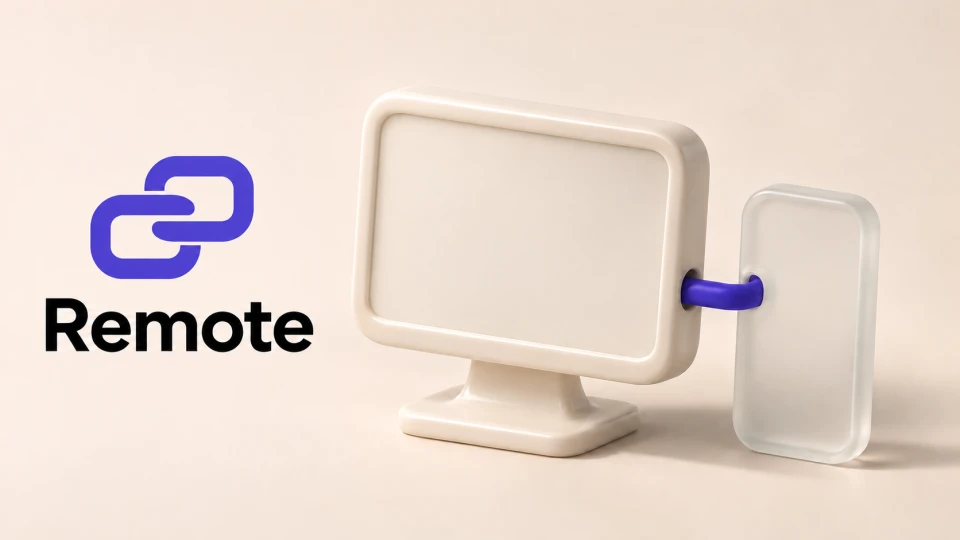
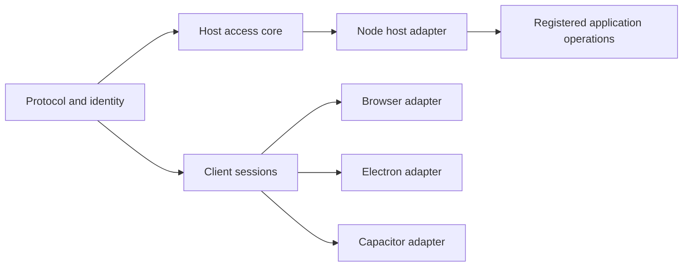

<p align="center">
  
</p>

# Remote

**A product-neutral TypeScript framework for pairing devices and connecting desktop applications across a local network.**

Reuse your application's operations and web interface in browser, desktop and mobile clients. Remote owns connection mechanics; your application owns the work.

[Website](https://pixel-brewery.github.io/remote/) · [Why Remote](#why-remote-exists) · [Architecture](#architecture) · [Developer setup](#developer-setup) · [Agent documentation](#documentation-for-your-coding-agent) · [Documentation](.docs/README.md) · [Product icon](.github/assets/remote-icon.png)

> **Status** · SDK `0.1.0` is published as nine public GitHub Packages. The [completed release](https://github.com/pixel-brewery/remote/actions/runs/45865646952) verifies the original package bytes and registry access. The [verification record](.docs/guides/testing.md) distinguishes automated SDK checks from application and native device evidence.

## Why Remote exists

Applications such as Symphony and Weasel need the same device pairing, connection lifecycle and transport mechanics. Their workflows and data differ. Remote gives them shared infrastructure while keeping product models, permissions and screens in the application.

An operator enables remote access, creates a short-lived pairing address and opens it on another device. The host grants only registered capabilities. It can revoke the device and close its connections. The host remains the execution owner.

## Architecture



| Application need             | Framework boundary                                               |
| ---------------------------- | ---------------------------------------------------------------- |
| Pair a new device            | Single-use challenge and device-scoped authorization             |
| Preserve existing APIs       | Registered HTTP operations and original streamed bodies          |
| Reconnect after interruption | Session lifecycle and product reconciliation notification        |
| Deliver events and content   | Bounded streams, cancellation and content URL adapters           |
| Use native clients           | Privileged credentials and a protected local content gateway     |
| Provide HTTPS                | Application-supplied TLS material; no framework issuer or domain |

The first configuration is HTTP LAN, an explicitly unencrypted transport. A QR code grants access; it does not encrypt network traffic. HTTPS adapters consume certificates supplied by the application. Remote contains no shared private key, product domain or hosted control service.

## Packages

All nine packages are available at version `0.1.0` in [GitHub Packages](https://github.com/orgs/pixel-brewery/packages?repo_name=remote). Consumers use the `@pixel-brewery` registry configuration and authenticated package access described in the [integration guide](.docs/guides/integrate-remote.md).

| Package                           | Responsibility                                        |
| --------------------------------- | ----------------------------------------------------- |
| `@pixel-brewery/remote-protocol`  | Validated wire contracts, identities and errors       |
| `@pixel-brewery/remote-core`      | Pairing, device authorization and revocation          |
| `@pixel-brewery/remote-node`      | Node hosts, transports, gateways and storage adapters |
| `@pixel-brewery/remote-client`    | Portable sessions and connection profiles             |
| `@pixel-brewery/remote-browser`   | Browser transport and pairing environment             |
| `@pixel-brewery/remote-angular`   | Functional providers and Signal projections           |
| `@pixel-brewery/remote-electron`  | Main, preload and utility-process integration         |
| `@pixel-brewery/remote-capacitor` | Native Android and iOS integration                    |
| `@pixel-brewery/remote-testing`   | Deterministic test adapters and contract fixtures     |

## Developer setup

Use Node.js 24.15 or later and the pinned Yarn 4.18.1. Supply `GITHUB_TOKEN` through the calling environment with read access to Pixel Brewery's GitHub Packages registry for the design-system dependency.

```sh
corepack enable
yarn install --immutable
yarn agents:sync
yarn agents:check
yarn agents:mcp-check
yarn build
yarn test
```

## Documentation for your coding agent

Start with [AGENTS.md](AGENTS.md). Remote derives its architecture and design skills from the same immutable Pixel Brewery foundations as Cursor. Architecture applies to every task; UI work also consults the pinned local Mosaik catalog.

Canonical instructions, roles and MCP configuration generate adapters for supported coding agents. Run `yarn agents:sync` after changes and `yarn agents:check` before handoff. The [reference record](.docs/reference.json) identifies the exact Cursor baseline.

## Documentation and verification

Read the [implementation handbook](.docs/architecture/remote-access/README.md), [host integration guide](.docs/guides/integrate-remote.md), [connection lifecycle](.docs/guides/reference-connection.md), [testing guide](.docs/guides/testing.md) and [API documentation guide](.docs/guides/api-documentation.md). The public TypeScript reference is generated from declarations and English TSDoc with `yarn docs`, then checked with `yarn docs:check`.

Package publication, deployment and native device verification are recorded separately. A successful build alone does not establish a tested device workflow.
